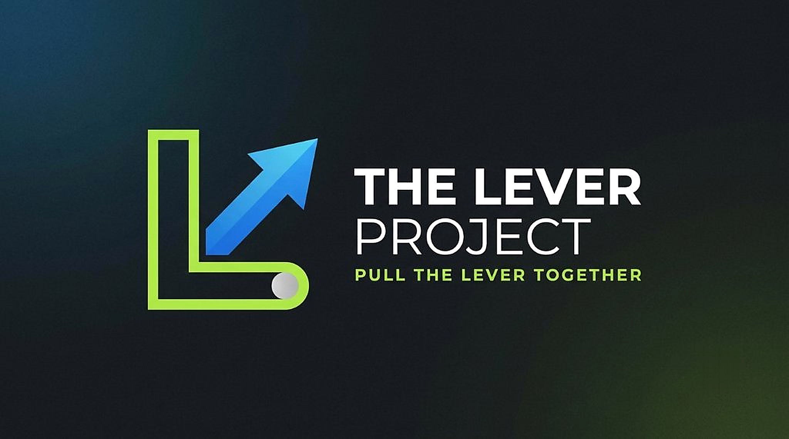

# The Lever Project — Pull The Lever Together

An exclusive partnership hub for **AI Income Challenge** members who want to launch digital products without fronting the software costs or needing a social media following.



## Overview & Blueprint Architecture

1. **Navigation Bar**: Minimalist `L` Logo (`The Lever Project`), Quick Links (`How it Works`, `The Split`, `IP Protection`), and `Submit Idea` CTA.
2. **Section 1 — The Hero (Above the Fold)**:
   - Headline: *"You Bring the Idea. I Have the Tool to Build It & Find the Buyers."*
   - Sub-headline: *"We leverage a $19,458+ software stack to build your digital product and automatically match it with an audience—without you fronting a single dollar."*
   - Dynamic Live Counter (`🟢 [X] Ideas Submitted and Protected`) backed by `/api/stats` & Airtable sync.
3. **Section 2 — The Reality (Open Letter)**:
   - *"Why I Built This Community"* — explicitly stating the `$1,997` cash investment for the challenge to unlock the `$19,458+` software stack, and that *"You don't need a social media following. Our tool finds the buyers."*
4. **Section 3 — The Strategy (The Slot Machine Method)**:
   - Interactive Slot Machine Lever simulator + breakdown of high-frequency testing.
5. **Section 4 — The Profit Split**:
   - **Phase 1 (The Recoup Phase)**: `50/50 Split` until the initial `$1,997 USD` challenge investment is covered.
   - **Phase 2 (The Growth Phase)**: `70/30 Split` (`70%` Creator for bringing the idea / `30%` The Lever Project for technical management, buyer matching & platform fees).
6. **Section 5 — IP Protection**:
   - Instant Tracking (`ID-001`, `ID-002`, ...), Immediate Validation, and Signed PDF IP Ownership Agreement from **The Lever Project** (`support@theleverproject.com`).
7. **Section 6 — Validated Application Form & Automated Backend**:
   - Collects First & Last Name, Email Address, Phone Number, The Core Idea (minimum 150 characters), and mandatory Agreement Checkbox.
   - Automatically generates a downloadable **Signed PDF IP Ownership Agreement** (`GET /api/agreement/:uniqueId`) under **The Lever Project**.

## Running Locally

```bash
npm install
npm start
```

Server runs on `http://localhost:3000` (or `PORT` specified in `.env`).
